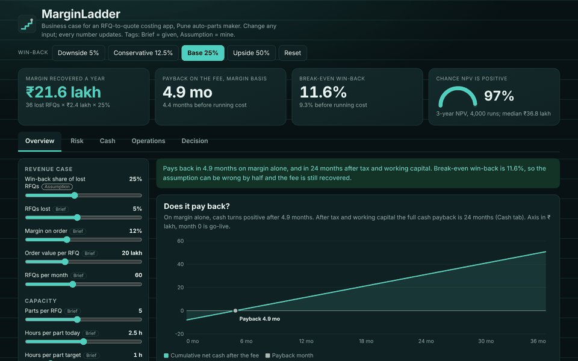
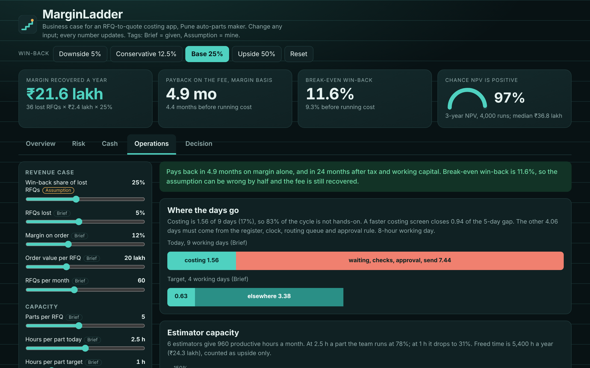

# MarginLadder

### Interactive RFQ-to-Quote Control Tower for Forging & Machining

**A working local product that connects RFQ workflow, deterministic costing, commercial approvals, operational diagnostics and investment decisions.**

[Open the local demo](#run-it-locally) · [See the business case](#the-decision) · [Review evidence](#quality-and-traceability)

> **Independent portfolio case.** MarginLadder is a hypothetical Pune auto-components manufacturer scenario. Bharat Forge is referenced only through its public FY26 disclosures as a range check. This is not an affiliated, internal, deployed, or production system.

## Watch the dashboard

The application opens directly with no login. This dashboard walkthrough shows the RFQ control centre, decision views and operational outputs in action.



## What you can interact with

<p align="center">
  
  
</p>
<p align="center">
  
  
</p>

| Explore | What it demonstrates |
|---|---|
| **RFQ workspace** | Searchable register, owners, due dates, statuses, overdue visibility and activity history |
| **Costing & quote snapshots** | Deterministic decimal calculations, dated rates, three volume tiers and saved quote versions |
| **Approval flow** | Configurable ₹25 lakh illustrative approval threshold and an append-only audit trail |
| **Business-case economics** | Contribution pool, break-even win-back, operating payback and scenario sensitivity |
| **Forging economics simulator** | Change steel cost, yield, cycle time, energy, utilisation and working-capital days live |
| **Sector benchmark** | Clearly sourced Bharat Forge FY26 public-data context, separate from synthetic case data |
| **Operational diagnostics** | Cycle-time baseline, application KPIs, queue model and capacity sensitivity |

## The decision

**Should a manufacturer fund RFQ-to-quote automation?**

The case starts with a 9-working-day modelled quote cycle against a 4-day target and an ₹8 lakh proposed build. Rather than assuming automation is the answer, MarginLadder tests where value could come from—and what must be true before scaling.

**Recommendation: pilot workflow visibility and approval control first; do not approve broad costing automation until observed stage-time and rework data show costing is the bottleneck.**

| Modelled decision output | Result | Interpretation |
|---|---:|---|
| Annual RFQs / lost at 5% | 720 / 36 | Brief input and derived arithmetic |
| Lost-RFQ contribution pool | ₹86.4 lakh | Ceiling of opportunity, not a forecast |
| Recovered contribution at 25% win-back | ₹21.6 lakh | Assumption-led scenario |
| Operating payback | 4.9 months | Pre-tax operating view; not cash payback |
| Cash payback | 23.6 months | Includes tax and working-capital assumptions |
| 3-year IRR | 75.8% | With working-capital release; sensitivity required |
| Estimator hours released | 5,400 gross / 4,680 net | Capacity released, not automatically cash savings |

## Run it locally

```bash
pip install -r requirements-dev.txt
uvicorn application.server:app --reload
```

Open [http://127.0.0.1:8000](http://127.0.0.1:8000). No account or password is required. The app creates a local SQLite database with fictional RFQs on first use.

### A quick product tour

1. Review the RFQ control centre, status cards and queue of work.
2. Open an RFQ, calculate three volume prices, then inspect the saved quote snapshot.
3. Change the **Demo role** to demonstrate the approval and routing paths.
4. Adjust a driver in the **Forging economics simulator** and see contribution and working-capital exposure update.
5. Review the Bharat Forge FY26 public benchmark alongside—not inside—the synthetic case.
6. Open the [original finance dashboard](http://127.0.0.1:8000/prototype/business_dashboard.html) for an additional interactive view.

## How the product is built

| Layer | Implementation | Quality signal |
|---|---|---|
| Workflow application | FastAPI + SQLite | RFQ tracking, transitions, demo role paths and audit events |
| Pricing engine | Python `Decimal` | Dated rate master, validated inputs, tier schedules and reproducible snapshots |
| Financial model | Excel + Python twin | Driver-based plan, cash view, NPV/IRR, sensitivity and reconciliation |
| Scenario layer | Deterministic Python API | Live forging-economics sensitivity with bounded inputs and tests |
| Analytics | Python, SQL and trace tools | Funnel/KPI analysis, queueing, capacity and sample-size tools |
| Documentation | Decision, product, BA and delivery packs | Traceability from problem through validation design |

## Bharat Forge context—used responsibly

The project uses selected public Bharat Forge FY26 disclosures to check whether the illustrative case sits in a plausible sector range. It does not use private data or claim to represent Bharat Forge operations.

| Public reference | Why it matters to the case |
|---|---|
| 17.4% EBITDA margin / 14.0% Forgings segment margin | Context for the case's 12% quote-margin assumption; not like-for-like |
| 45.1% material share of revenue | Context for input-cost exposure and the forging simulator |
| 85 receivable days / 136-day cash conversion cycle | Shows why the case's 45-day working-capital assumption requires stress testing |

Read the source, method and limits in [the public-data benchmark note](docs/finance/real_company_benchmark.md).

## Quality and traceability

Every important statement is designed to be inspectable:

- **Public benchmark:** audited public filing data, with source and limits
- **Synthetic application data:** fictional RFQs and demo workflow events
- **Assumptions:** labelled commercial and operating inputs requiring real-world validation
- **Derived outputs:** transparent arithmetic from those inputs

```bash
pytest
python -m finance.reconcile
python -m realdata.benchmark
python scripts/check_consistency.py
python scripts/portfolio_release_audit.py
```

The financial reconciliation currently matches 64 of 64 checked workbook cells. See the [evidence ledger](docs/portfolio/evidence_ledger.md), [model audit](docs/finance/model_audit.md), [UI workflow check](docs/validation/ui_workflow_check.md), and [forging simulator methodology](docs/finance/forging_economics_simulator.md) for the underlying evidence and boundaries.

## Repository map

```text
application/   Local interactive FastAPI workspace
engine/        Deterministic costing, rate and tier-pricing logic
finance/       Business-case, scenario and reconciliation models
analytics/     SQL, product metrics and decision-analysis utilities
model/         Financial planning and valuation workbooks
docs/          Evidence, methodology, validation and decision records
```

## What would make this decision-grade in the real world?

The next step is not more automation. It is evidence: interview estimators, sales and finance users; capture real RFQ stage timestamps; validate rate ownership; and compare pilot outcomes against pre-agreed cycle-time, compliance and margin guardrails. See the [validation plan](docs/portfolio/validation_plan.md).

---

Built by **Suvam Priyaranjan Sahoo** · [GitHub](https://github.com/suvampriyaranjansahoo) · [LinkedIn](https://linkedin.com/in/suvampriyaranjansahoo-18b7412bb) · [Portfolio](https://suvampriyaranjansahooportfolio.vercel.app)
