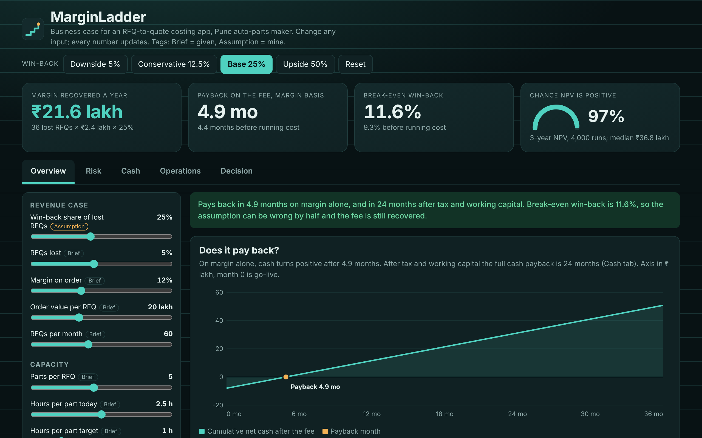
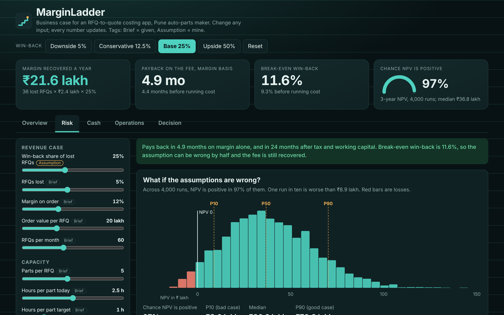
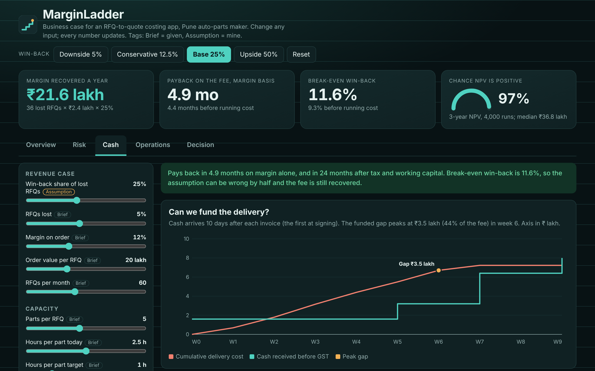
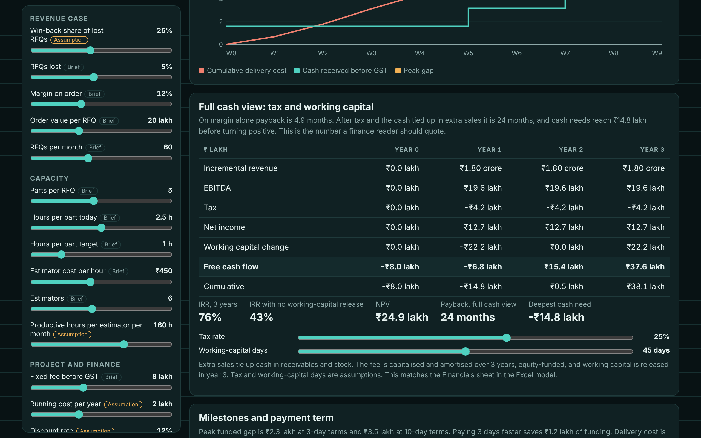
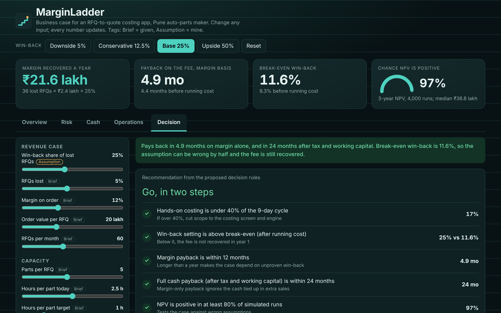
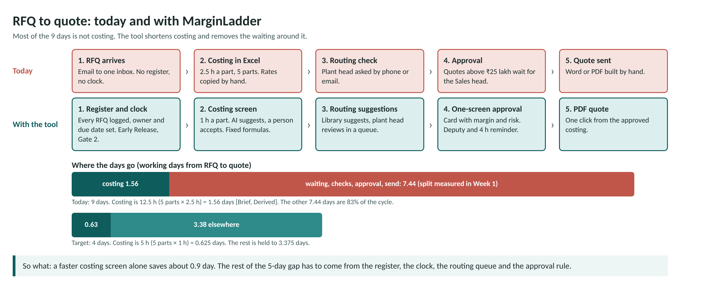
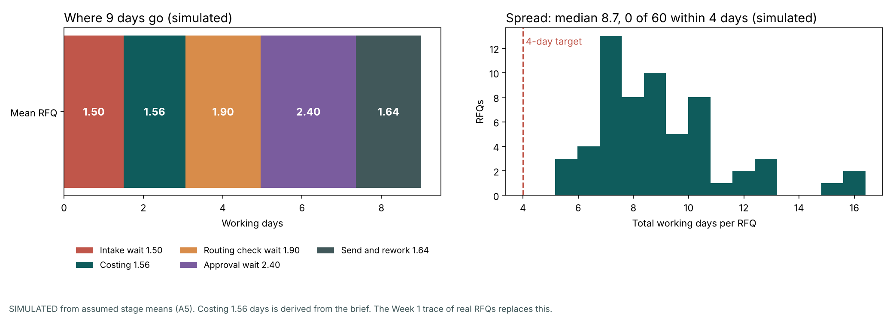

# MarginLadder: RFQ-to-quote costing app (product case study)

**One line.** A costing app for a Pune auto-parts maker that cuts RFQ-to-quote from 9 working days to a 4-day target and takes costing from 2.5 h to 1 h a part.

**Status.** Case study for a 7-week, ₹8 lakh build. Written as a PRD, plan, draft agreement and prototype. There is no live client. Numbers beyond the brief are my assumptions and are marked.


**Try it:** open `prototype/business_dashboard.html` in a browser, or host the repo with GitHub Pages (Settings, Pages, branch `main`) and link `/prototype/business_dashboard.html` here. Move the win-back slider, switch the payment term, open the Risk tab for a 4,000-run simulation, and read the Decision tab for the go / no-go call.

| Overview | Risk |
|---|---|
|  |  |
| **Cash** | **Operations** |
|  |  |







## The problem (from the brief)
- 60 RFQs a month, 5 parts each, 2.5 h a part at ₹450/h. 6 estimators.
- 9 working days from RFQ to quote against a 4-day target.
- 5% of RFQs are lost. Each lost RFQ is ₹20 lakh at 12% margin.
- 12.5 h of costing is 1.56 days, so about 83% of the 9 days is not hands-on costing.

## The bet
Waiting, not costing, is most of the delay. A register, a clock and a one-screen approval remove it. A faster costing screen removes the rest. If the Week 1 trace shows costing is over 40% of the cycle, cut the scope to costing only.

## What I built
| Item | Where |
|---|---|
| Process map: today and with the tool | `docs/process_as_is_to_be.png` |
| Swimlane maps: as-is and to-be, by role | `docs/ba/swimlane_as_is.png`, `docs/ba/swimlane_to_be.png` |
| Stakeholders, RACI and objections | `docs/ba/raci_stakeholders.md` |
| 12 user stories with Given / When / Then criteria | `docs/ba/user_stories.md` |
| Gap analysis, KPI definitions, Week 1 baseline method, why 70% | `docs/ba/gap_analysis_and_kpis.md` |
| Simulated cycle-time log (placeholder for the real trace) and chart | `data/simulated_rfq_log.csv`, `docs/ba/cycle_time_simulated.png` |
| Requirements to tests (AT-01 to AT-12) | `docs/requirements_traceability.md` |
| One-page answer-first memo with issue tree (consulting format) | `docs/one_page_memo.pdf`, `docs/one_page_memo.png` |
| Go / no-go memo with kill criteria | `docs/go_no_go_memo.md` |
| Finance model with scenario toggle: payback, break-even, NPV, cash gap, plus the client's incremental P&L, cash flow and balance sheet with IRR | `model/MarginLadder_finance_model.xlsx` |
| Costing screen prototype, open in a browser | `prototype/costing_demo.html` |
| Interactive dashboard, five tabs: overview, risk (4,000-run simulation and tornado), cash, operations, decision rules. Dark and light themes | `prototype/business_dashboard.html` |
| Approval card prototype: role switch, send-back reason, ₹25,00,000 boundary check | `prototype/approval_card.html` |
| Fixed-formula costing engine and 24 unit tests | `engine/cost_engine.py`, `engine/test_results.txt` |
| 20-minute user call script | `docs/user_research_script.md` |




*Simulated from assumed stage means. Only the 1.56 days of costing comes from the brief. The Week 1 trace replaces it.*

## Key numbers
| Measure | Value | Tag |
|---|---|---|
| Margin recovered at 25% win-back | ₹21.6 lakh a year | Assumption (50% quotable × 50% won) |
| Conservative (12.5%) | ₹10.8 lakh a year | Assumption |
| Payback on ₹8 lakh | 4.4 and 8.9 months (4.9 and 10.9 after ₹2 lakh a year running cost) | Derived |
| Break-even win-back | 9.3% (11.6% after running cost) | Derived |
| Estimator hours freed | 5,400 a year, ₹24.3 lakh, counted as upside only | Derived |
| Estimator load | 78% today, 31% at 1 h a part | Derived |
| Peak funded gap, cash-received basis | about ₹3.5 lakh (44% of the fee) at net-10 terms | Derived |
| Payback after tax and working capital | 24 months (4.9 on margin alone); IRR 76% over 3 years, NPV ₹24.9 lakh at 12% | Derived, tax 25% and 45 working-capital days are assumptions |

## Market context and benchmarks
- Indian auto-component industry turnover was ₹7.60 lakh crore in FY26, up 12.7% ([ACMA, via Autocar Professional, 7 July 2026](https://www.autocarpro.in/news/acma-indian-auto-component-industry-grows-127-percent-to-inr-76-lakh-crore-in-fy26-133454)).
- Operating margin for 59 listed auto-component companies was 13.6% in FY26, flat on the year ([Elara Capital, via Kotak Neo](https://www.kotakneo.com/news/sectors/auto-ancillaries-fy26-revenue-growth-margins-elara-report/)). This case uses 12%, from the brief, which is 1.6 points below that peer figure. Listed firms are larger than a 320-person plant, so treat it as a sense check, not a match.
- I found no reliable independent source for the win-back rate after faster quoting. The results were vendor blogs. The 25% stays an assumption and the Risk tab tests a 0 to 50% range.

## Limits and corrections
- **Payback was too rosy on margin alone.** The 4.4 and 4.9 month figures ignore tax and the cash tied up in receivables and stock on the extra sales. After both, payback is about 24 months and the client's cash need reaches ₹14.8 lakh (Financials sheet, dashboard Cash tab).
- **The vendor's cash gap was understated.** An early version counted invoices raised, not cash received. On a cash-received basis the peak gap is about ₹3.5 lakh, not ₹1.2 lakh.
- **The 9-day split is not measured.** Only costing (1.56 days) comes from the brief. The simulated log and the wait-time split are placeholders for the Week 1 trace.
- **No client data.** Win-back (25%), running cost (₹2 lakh a year), discount rate and the Monte Carlo ranges are assumptions. The peer margin check in the model uses the 13.6% listed-company figure above.

## Design choices and trade-offs
- **Cash first.** The case counts recovered margin, not time saved. Time saved becomes cash only if the team quotes more.
- **AI extracts, a person accepts, fixed formulas price.** No price is shown until every AI value is accepted.
- **₹25 lakh approval rule.** A trigger at 70% of quotes keeps mean approval wait at 0.70 day, inside a 0.75-day budget.
- **Early Release at Gate 2.** The register and clock ship first and are a condition of the second payment.
- **Payments 20/20/40/20.** 60% is paid only after delivery and acceptance. The cost is a funding gap, shown in the model.

## What I would do next
1. Run three calls with the script in `docs/user_research_script.md` and replace the assumptions with quotes.
2. Run the Week 1 trace on 10 recent RFQs and replace the stage split with timestamps.
3. Deploy both prototypes with GitHub Pages and link them at the top of this README.

## Run it
```
open prototype/costing_demo.html
open prototype/approval_card.html
open prototype/business_dashboard.html
python3 engine/cost_engine.py     # prints the worked example and runs 24 tests
```
