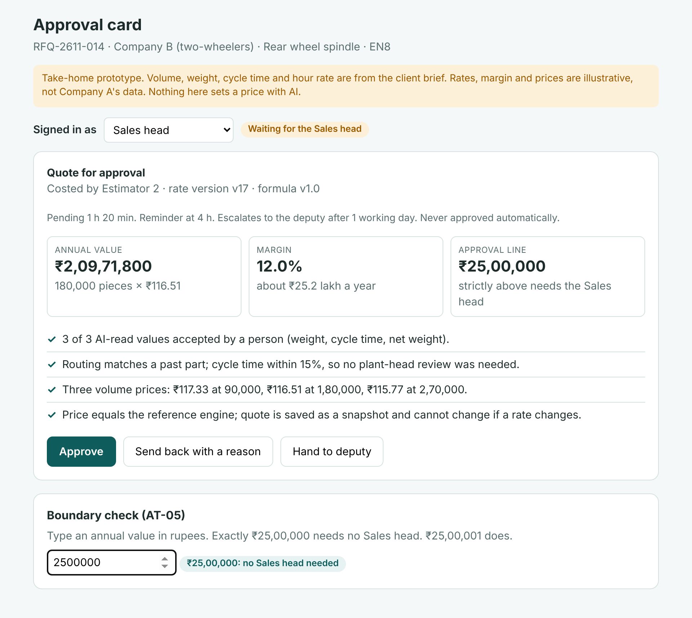

# MarginLadder — one RFQ-to-quote decision case, five role front doors

**Start with the row for your role in the table below.** Each path is a 5-minute route through the same case: finance is the numeric spine, and the other roles read it from their own angle.

**Decision question:** Should a hypothetical Pune auto-components manufacturer invest in an RFQ costing workflow, and what evidence would justify that investment?

**Recommendation:** Do not approve a broad automation rollout on assumptions alone. First measure RFQ stage timestamps, rework, quote accuracy and loss reasons; pilot a reversible queue-visibility and approval workflow; expand costing automation only if observed evidence shows costing is a material bottleneck.

> **Case boundary:** Hypothetical case study and local MVP. All case inputs and benefits are assumptions or derived calculations; sample operational/product records are synthetic. There are no production users and no real customer interviews; no customer adoption, signed UAT, production deployment or realised financial benefit is claimed.

## Five-minute recruiter route
1. `docs/portfolio/one_minute_case_brief.md` — decision and recommendation.
2. `docs/portfolio/evidence_ledger.md` — claim source and verification status.
3. `docs/consulting/MarginLadder_Executive_Recommendation.pptx` — 16-slide case deck.
4. `model/MarginLadder_Monthly_FP&A_Model.xlsx` — monthly model and visible audit checks.
5. Your role's path in `docs/portfolio/role_paths/` (table below).

## Demo (screenshots; hypothetical case, synthetic data)


*Dashboard: move the win-back slider and watch payback, break-even and cash change. Each input is tagged Brief, Assumption or Derived. The 97% "chance NPV is positive" comes from a simulation over my own assumed ranges, so it shows sensitivity and is not a forecast.*

| Approval card | Costing screen |
|---|---|
|  |  |

*Illustrative prototype screens. Rates, margins and prices are made up for the case. Nothing sets a price with AI.*

**Try it yourself in 3 steps (about 2 minutes):**
```bash
pip install -r requirements.txt
uvicorn application.server:app --reload      # then open http://127.0.0.1:8000
python3 scripts/developer_task_run.py         # or: run 3 scripted workflow tasks, no browser needed
```
No live hosted link exists yet. When one does, it will be listed here and marked as a demo on synthetic data.

## Financial answer at a glance

The modelled lost-RFQ contribution pool is ₹86.4 lakh. Recovered margin is ₹21.6 / ₹10.8 lakh in the base / conservative cases. Operating payback is 4.9 months in the base case and 10.9 months in the conservative case; cash payback is 23.6 months. The three-year IRR is 75.8%, with a deepest cash need of ₹14.8 lakh; IRR without working-capital release is 43.0%.

The model estimates 5,400 / 4,680 gross / net hours released and estimator load of 78% / 31%. The queue wait estimate is 0.57 day. Capacity break-even fit is 46%. Break-even win-back is 11.6% including run cost and 9.3% for fee only. These are scenario outputs, not observed outcomes.


| Metric | Base case | Meaning |
|---|---:|---|
| Annual RFQs | 720 | 60 per month × 12 |
| Lost RFQs | 36 | 5% assumed loss rate |
| Lost-RFQ contribution pool | ₹86.4 lakh | 36 × ₹20 lakh AOV × 12% margin |
| Recovered contribution | ₹21.6 lakh | 25% assumed win-back; not realised |
| Annual run cost | ₹2.0 lakh | Case assumption |
| Net annual contribution after run cost | ₹19.6 lakh | Before tax and working capital |
| Implementation fee | ₹8.0 lakh | Case assumption |
| Operating payback | 4.9 months | Pre-tax and before working capital |
| Cash payback | 23.6 months | Includes additional tax and working-capital assumptions |

Do not conflate operating payback with cash payback. Released estimator capacity is not cash savings unless a cash-releasing action is evidenced.

## Role paths — pick your door
| Target role | Walkthrough | Evidence demonstrated |
|---|---|---|
| Product Finance Analyst | `docs/portfolio/role_paths/product_finance_analyst.md`, `docs/finance/decision_grade_model.md` and `docs/finance/decision_bridge.md` | Adoption-adjusted economics, investment decision, cash and payback |
| Finance Analyst | `docs/portfolio/role_paths/finance_analyst.md` | Driver model, FP&A, variance and reconciliation |
| Business Analyst | `docs/portfolio/role_paths/business_analyst.md` | Process, requirements, traceability and UAT design |
| Associate Product Manager | `docs/portfolio/role_paths/apm.md` | Problem framing, MVP scope, prioritisation and metrics |
| Consulting Analyst | `docs/portfolio/role_paths/consulting_analyst.md` | Issue tree, options, recommendation, decision analysis, market sizing and gates |
| Project / Programme Manager | `docs/portfolio/role_paths/project_manager.md` | Phased plan, decision gates, pilot design, risks and stakeholder cadence |

## Product and technical scope
- Local FastAPI/SQLite RFQ workflow prototype with role checks, approvals and audit events; not hosted or ERP-integrated.
- Decimal-based costing engine with rate master and quote snapshots.
- Monthly driver-based FP&A workbook and Python calculation/reconciliation support.
- Valuation and decision workbook (`model/MarginLadder_finance_extension.xlsx`): DuPont, DCF, reverse DCF and peers on a listed auto-component maker, win-back stress grid, decision tree and market sizing. Public-data modelling exercise, not investment advice. See `docs/finance/extension_summary.md`.
- Synthetic analytics examples, PRD, requirements, UAT design and executive recommendation.

## Run and verify
```bash
pip install -r requirements-dev.txt
pytest
python3 -m finance.reconcile
python3 -m finance.monthly_plan
python3 scripts/check_consistency.py
python3 scripts/portfolio_release_audit.py
python3 scripts/check_role_packs.py
python3 scripts/make_pm_artifacts.py   # rebuilds the Gantt and RACI from docs/pm/plan.csv
uvicorn application.server:app --reload
```

## Evidence taxonomy
- **Case input:** stated in the hypothetical brief.
- **Derived:** arithmetic from case inputs.
- **Assumption:** estimate requiring validation.
- **Synthetic:** generated records for method demonstration.
- **Observed:** reserved for real participant/system evidence; none is claimed here.

Permitted claim: “Built a driver-based investment case and local RFQ workflow MVP; modelled contribution recovery under explicit scenarios.”

Do not claim recovered revenue, cycle-time reduction, realised savings, product-market fit or customer deployment.

## Documentation map

Canonical source register: `docs/CANONICAL_DOCUMENTS.md`. Financial decision bridge: `docs/finance/decision_bridge.md`.

Finance: `docs/finance/` · BA: `docs/ba/` · Product: `docs/product/` · Consulting: `docs/consulting/` · Portfolio: `docs/portfolio/` · Historical versions are identified by their versioned filenames; use the canonical register.


## Product Finance deep-dive additions
- `docs/portfolio/Investment_Memo.md` — concise investment recommendation and capital gates.
- `docs/finance/decision_grade_model.md` — adoption-adjusted economics, model definitions and downside discipline.
- The recruiter-facing workbook includes an `Adoption Economics` sheet; the monthly plan links its effective win-back directly to adoption × incremental lift assumptions.

## New role evidence packs
- Project Manager: `docs/pm/schedule_and_critical_path.md` (computed Gantt and critical path), `docs/pm/raci_tasks.md`, `raid_log.md`, `change_control_and_communications.md`, `status_reports_templates.md` and `resourcing_effort.md`.
- APM / PM: `docs/product/apm_pm_decision_pack.md`.
- Consulting: `docs/consulting/consulting_challenge_pack.md`; slides 8, 14 and 15 of the deck (option weights, red team, what would change my mind).
- Business Analyst: `docs/ba/complete_traceability_and_process_pack.md`.
- Finance: `docs/finance/finance_manager_reproduction_pack.md`; workbook sheets `Audit Checks` and `Tornado`; chart `docs/finance/tornado.png`.
- Claim ledger: `docs/portfolio/evidence_ledger.md`. Developer-run task script (no people involved): `docs/validation/developer_task_run.md`. Blank validation templates and the independent UAT protocol (not executed): `docs/validation/`, `docs/ba/independent_uat_and_signoff_protocol.md`.

All status, research, consent and UAT templates remain empty. No participant session, sign-off, live deployment or financial benefit is claimed.
