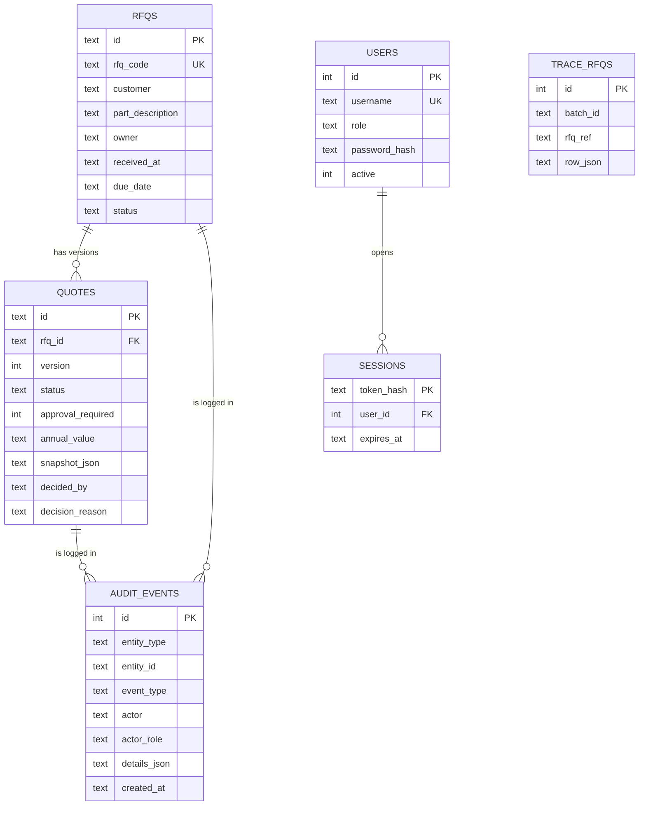
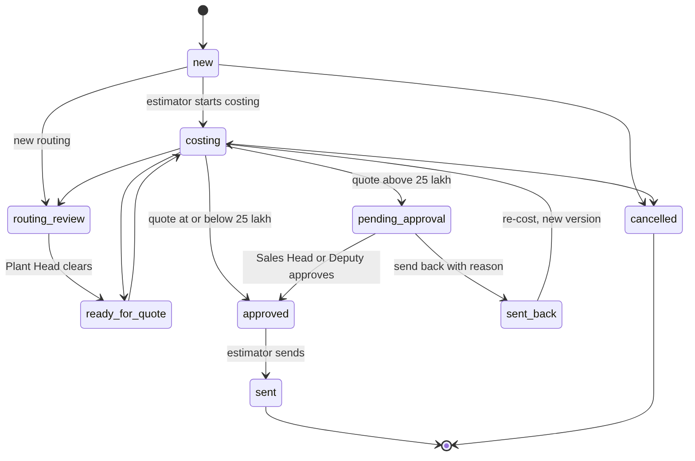

# Data dictionary

Database: SQLite, one file. Migrations v1 to v3 run on start (`schema_version` table). Diagram: `docs/ba/diagrams/er.png`, source `er.mmd`.

| Table | Column | Type | Meaning | Rule |
|---|---|---|---|---|
| `rfqs` | `id` | text | Internal identifier (UUID) | Primary key |
| | `rfq_code` | text | Human code `RFQ-YYMM-NNN` | Unique, BR-03 |
| | `customer`, `part_description`, `owner` | text | Who asked, for what, who owns it | Required, BR-01 |
| | `received_at` | text, ISO time (UTC) | When the RFQ was registered | Start of the cycle clock |
| | `due_date` | text, ISO date | Promised quote date | BR-02 |
| | `status` | text | One of nine statuses | BR-04, state diagram below |
| `quotes` | `rfq_id`, `version` | text, int | One row per costing run | Unique pair, BR-15 |
| | `status` | text | `pending_approval`, `approved`, `sent_back`, `sent` | BR-11, BR-16 |
| | `approval_required` | int (0 or 1) | Whether BR-11 applied | |
| | `annual_value` | text (decimal) | Annual selling value before GST at the chosen tier | Decimal kept as text to avoid float drift |
| | `snapshot_json` | text | Inputs, three tiers, rate and formula versions | BR-09, never edited |
| | `decided_by`, `decided_at`, `decision_reason` | text | Who decided, when, why | BR-14 |
| `audit_events` | `entity_type`, `entity_id`, `event_type` | text | What happened to what | BR-17, append only |
| | `actor`, `actor_role`, `details_json`, `created_at` | text | Who, in which role, details, when | No passwords or tokens |
| `users` | `username`, `role`, `password_hash`, `active` | text, int | Demo accounts | scrypt hash, BR-18 |
| `sessions` | `token_hash`, `user_id`, `expires_at` | text | Open sessions | Only the SHA-256 of the token is stored, BR-20 |
| `login_failures` | `username`, `failed_at` | text | Failed sign-ins | BR-19 |
| `trace_rfqs` | `batch_id`, `rfq_ref`, `row_json` | text | Imported real timestamps | BR-21 |

## RFQ status paths

The quote step sets the status directly: above ₹25 lakh the RFQ goes to `pending_approval`, otherwise to `approved`. The manual paths in the table are the ones `update_rfq` allows.

## Event types used by the KPIs

| Event | Written when | Used by |
|---|---|---|
| `rfq_created` | An RFQ is registered | Start of time to quote |
| `rfq_updated` with `status = costing` | Costing starts | Intake to costing wait |
| `quote_costed` | A quote version is saved | Quote count |
| `approval_requested` | A quote above ₹25 lakh is saved | Start of approval wait |
| `quote_approved`, `quote_sent_back` | A decision is made | End of approval wait |
| `quote_sent` | An approved quote is marked sent | End of time to quote |
| `login`, `login_failed`, `user_created`, `trace_imported` | Account and import actions | Security review |
