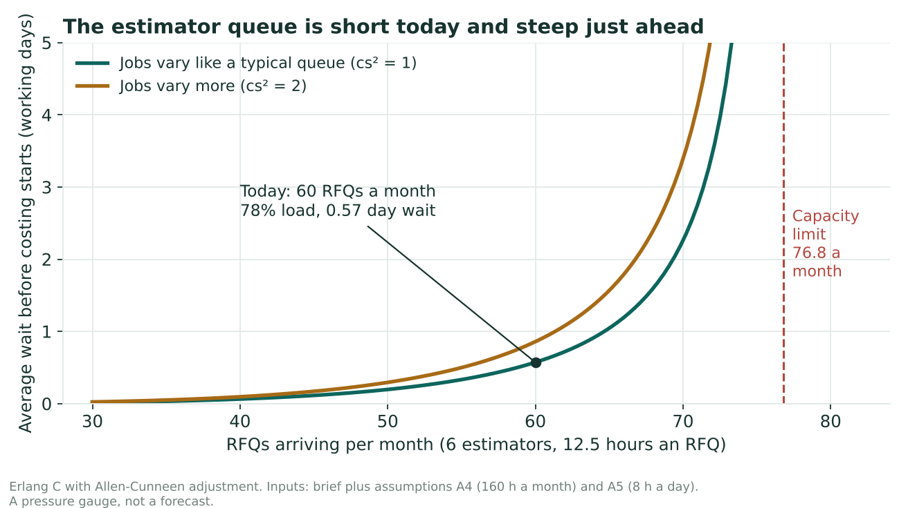
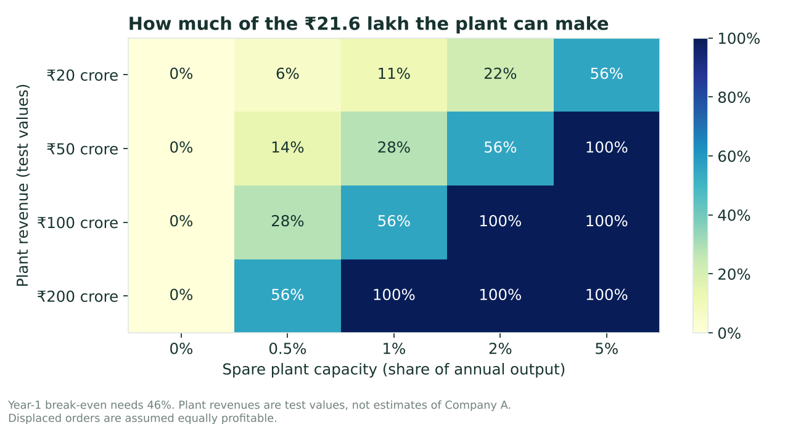

# Two questions the base case skips: why do RFQs wait, and can the plant make the won orders?

Tags: Brief, Derived, Assumption, Judgement. Code: `finance/queueing.py`, `finance/capacity.py`. Tests: `finance/test_full_model.py`.

## 1. Why do RFQs wait? An estimator queue model

**Setup.** 60 RFQs arrive a month [Brief]. Each takes about 12.5 hours to cost (5 parts × 2.5 h) [Brief]. Six estimators [Brief] have 160 productive hours a month each [Assumption A4]. A working day is 8 hours [Assumption A5]. Arrivals are random and job times vary like a standard queue [Assumption]. Erlang C then gives the chance a new RFQ finds every estimator busy and the average wait before costing starts.

| Case | Load | Chance a new RFQ waits | Average wait before costing |
|---|---|---|---|
| Today, 12.5 h an RFQ | 78% | 48% | **0.57 day** (4.6 hours) |
| Jobs vary twice as much (cs² = 2) | 78% | 48% | 0.86 day |
| At 1 h a part (5 h an RFQ) | 31% | 1% | 0.002 day |
| Arrivals up 10% (66 a month) | 86% | 65% | 1.19 days |
| Arrivals up 20% (72 a month) | 94% | 83% | 3.47 days |
| One estimator leaves (5 of 6) | 94% | | 4.24 days |
| One estimator added (7 of 6) | 67% | | 0.17 day |

**What this changes.**
1. **The estimator queue explains less than one day of the 7.44 days that are not costing.** The rest sits in approval, routing, intake and customer holds. The bet ("waiting, not costing") holds, but the waiting is mostly *not* waiting for an estimator. The register and clock must make approval and routing waits visible, not only costing.
2. **78% load is on the knee of the curve.** A 10% rise in RFQs doubles the wait. Losing one estimator multiplies it by 7. This is a key-person risk the brief does not state.
3. **Faster costing buys headroom, not cash.** At 1 h a part, RFQs could double to 120 a month and the average queue wait would still be 0.06 day. That is the real value of the freed hours, and it is why D-03 counts them as upside only.
4. **Work in progress falls from 27 to 12 RFQs** at 9 and 4 days (Little's law: 60 a month ÷ 20 working days × cycle days).

**Limits.** Real estimators split jobs, pause them and take urgent work. Job times are not exponential. This is a pressure gauge to point the Week 1 trace at the right stage, not a forecast. The trace replaces it.

## 2. Can the plant make the orders a faster quote wins back?

**The gap in the base case.** It counts 12% margin on every recovered order [Derived]. If the plant is full, a won order displaces another order and the net gain is the margin *difference*, which can be near zero. The business review lists this as open weakness 2.

**Numbers.** Recovered orders are 36 lost RFQs × 25% × ₹20 lakh = ₹1.8 crore of revenue a year [Derived]. Year-1 break-even needs (₹8 lakh + ₹2 lakh) ÷ ₹21.6 lakh = **46% of that margin**. So the plant must be able to make at least 46% of the won-back orders without displacing others (displaced orders assumed equally profitable) [Derived].

**Reading the grid.** Plant revenue is unknown, so the grid uses test values. At ₹100 crore a year, 1% spare capacity covers 56% of the recovered margin, which clears break-even. At ₹20 crore, 5% spare covers 56%. Spare capacity of 2% on a ₹100 crore plant is enough for all of it.

**A check on the test values.** The brief's volumes imply a pipeline of 720 RFQs × ₹20 lakh = ₹144 crore a year [Derived]. With 5% lost, that is a 95% win rate and about ₹137 crore of won orders, if every order is annual [Derived]. A 95% win rate is unusual. It suggests "lost" means something narrower than "not won", or that ₹20 lakh is not annual. Ask the client which. If the plant really makes about ₹137 crore, the ₹20 to 50 crore rows of the grid are too small and 1% spare capacity covers about 76% of the recovered margin.

**What I need from the plant head (Week 1).** Annual output in rupees, the share of output the plant could add without overtime or new machines, and which customers' orders it would drop first if full. With those three numbers the grid becomes one cell.

**If the answer is bad.** Re-run the case with a displaced-margin ratio below 1.0 (`finance.capacity.realised_margin`). If the plant is full and displaced orders earn 12% too, the recovered margin is zero and the case rests on the estimator hours alone, which does not pay back the fee on its own.
