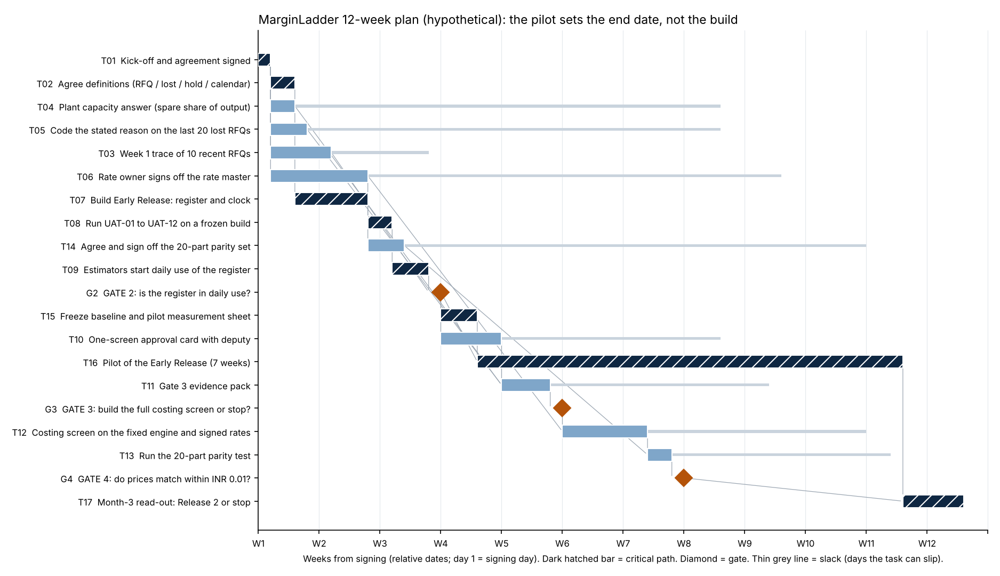

# Schedule and critical path (generated)

Generated by `scripts/make_pm_artifacts.py` from `docs/pm/plan.csv`. Do not edit by hand. **TEMPLATE plan for a hypothetical case: dates are relative to signing day, not calendar dates.** A working week has 5 days.

**Critical path** (a task here that slips one day moves the end date one day): `T01 > T02 > T07 > T08 > T09 > G2 > T15 > T16 > T17`. Plan ends on day 58 of 60, so the buffer is 2 days.

| ID | Task | Start day | End day | Week | Slack (days) | Depends on | Owner (A) | Critical |
|---|---|---:|---:|---|---:|---|---|---|
| T01 | Kick-off and agreement signed | 1 | 1 | W1 | 0 | none | MD | **yes** |
| T02 | Agree definitions (RFQ / lost / hold / calendar) | 2 | 3 | W1 | 0 | T01 | EH | **yes** |
| T04 | Plant capacity answer (spare share of output) | 2 | 3 | W1 | 35 | T01 | PH | no |
| T05 | Code the stated reason on the last 20 lost RFQs | 2 | 4 | W1 | 34 | T01 | SH | no |
| T03 | Week 1 trace of 10 recent RFQs | 2 | 6 | W1-W2 | 8 | T01 | EH | no |
| T06 | Rate owner signs off the rate master | 2 | 9 | W1-W2 | 34 | T01 | RO | no |
| T07 | Build Early Release: register and clock | 4 | 9 | W1-W2 | 0 | T02 | DL | **yes** |
| T08 | Run UAT-01 to UAT-12 on a frozen build | 10 | 11 | W2-W3 | 0 | T07 | BA | **yes** |
| T14 | Agree and sign off the 20-part parity set | 10 | 12 | W2-W3 | 38 | T06 | SH | no |
| T09 | Estimators start daily use of the register | 12 | 14 | W3 | 0 | T08 | EH | **yes** |
| G2 | GATE 2: is the register in daily use? | 15 | 15 | W3 | 0 | T09, T03 | MD | **yes** |
| T15 | Freeze baseline and pilot measurement sheet | 16 | 18 | W4 | 0 | G2 | BA | **yes** |
| T10 | One-screen approval card with deputy | 16 | 20 | W4 | 18 | G2 | DL | no |
| T16 | Pilot of the Early Release (7 weeks) | 19 | 53 | W4-W11 | 0 | G2, T15 | PO | **yes** |
| T11 | Gate 3 evidence pack | 21 | 24 | W5 | 18 | T04, T05, T10 | PO | no |
| G3 | GATE 3: build the full costing screen or stop? | 25 | 25 | W5 | 18 | T11 | MD | no |
| T12 | Costing screen on the fixed engine and signed rates | 26 | 32 | W6-W7 | 18 | G3, T06 | DL | no |
| T13 | Run the 20-part parity test | 33 | 34 | W7 | 18 | T12, T14 | EH | no |
| G4 | GATE 4: do prices match within INR 0.01? | 35 | 35 | W7 | 18 | T13 | MD | no |
| T17 | Month-3 read-out: Release 2 or stop | 54 | 58 | W11-W12 | 0 | T16, G4 | MD | **yes** |

## How to read it in 60 seconds
- **What is late?** In this template nothing is late, because nothing has started. In a live plan, anything on the critical path that slips is late for the whole project. Anything with slack can slip by that many days first.
- **Who owns it?** The Owner (A) column. One name per task.
- **What happens next?** Gates: Gate 2 on day 15 (register in daily use), Gate 3 on day 25 (full build or stop), Gate 4 on day 35 (prices match within INR 0.01). Pass rules are in `docs/strategy/rollout_30_60_90.md` and `docs/product/roadmap.md`.
- **Why the pilot is critical:** `pilot_design.md` asks for at least 6 weeks of pilot data. Seven weeks starting right after Gate 2 ends on day 50, which is later than the build chain, so a late pilot start moves the read-out.
