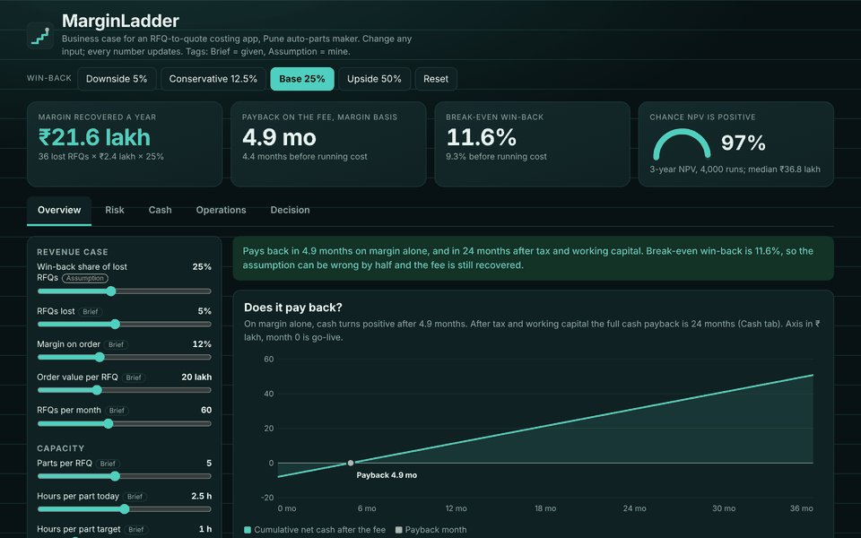
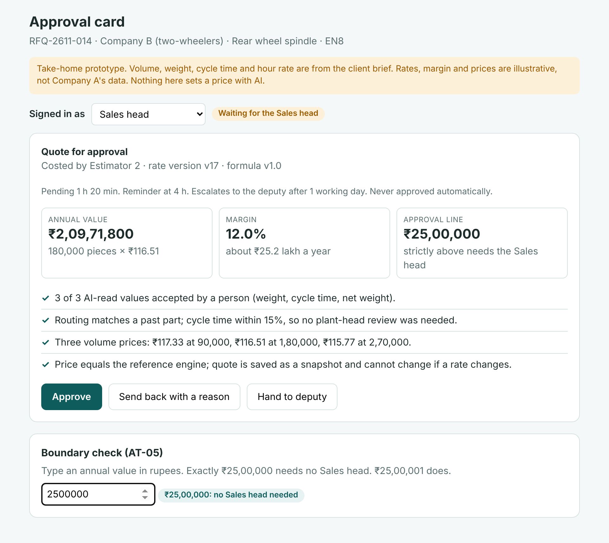
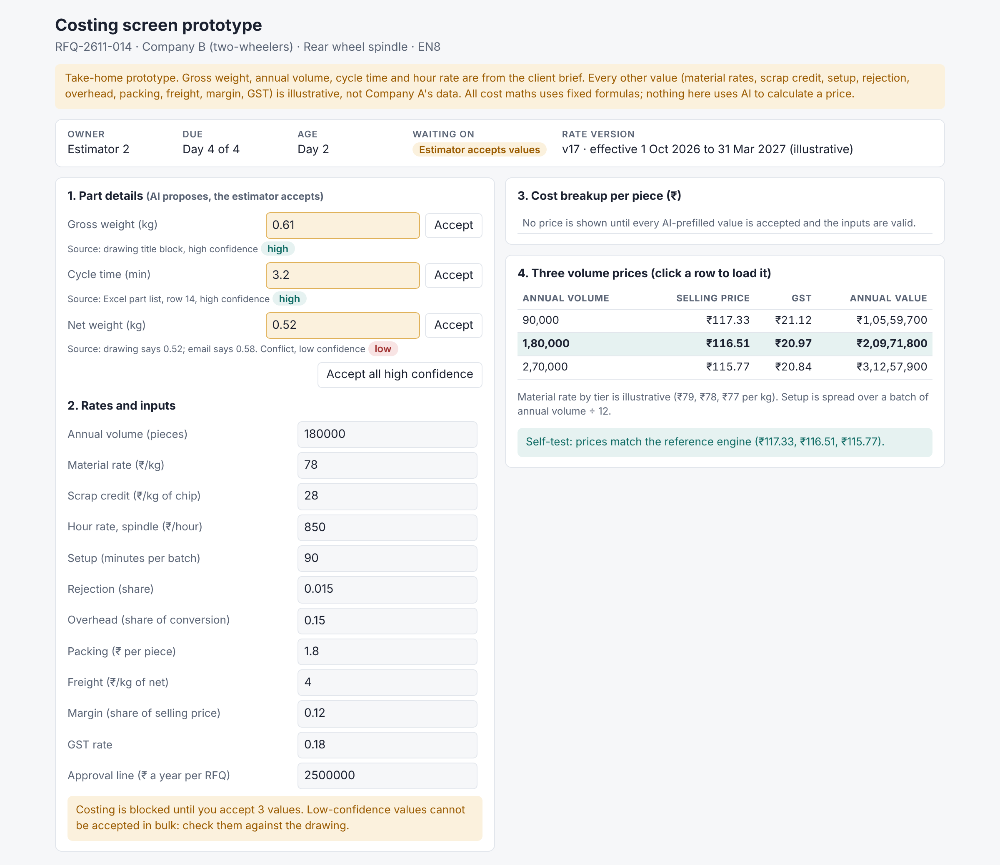

# MarginLadder
### RFQ-to-Quote Intelligence | Financial Modelling | Workflow Automation | Business Decision Systems

**A cross-functional business solution connecting operational workflows, financial planning, commercial analysis and investment decisions.**

---

## Executive Overview

MarginLadder is an integrated RFQ-to-quote workflow and financial decision-support platform developed around the commercial operations of an automotive components manufacturer.

The project combines a functional Python-based workflow application, a structured costing engine, driver-based financial models, business analysis documentation and investment decision frameworks.

It addresses a fundamental business challenge:

**How can an organisation improve quotation efficiency, protect contribution margins and determine whether workflow automation creates sufficient economic value to justify investment?**

Instead of approaching automation as an isolated technology upgrade, MarginLadder connects operational performance with financial outcomes.

### Platform Capabilities

| Business Function | Capabilities |
|---|---|
| RFQ Operations | Registration, workflow tracking and status management |
| Approval Management | Role checks, approval rules and audit events |
| Commercial Costing | Rate master, Decimal calculations and quote snapshots |
| Financial Planning | Monthly driver-based FP&A and financial reconciliation |
| Investment Analysis | DCF, NPV, IRR, payback and sensitivity analysis |
| Business Intelligence | KPI analysis, scenario modelling and financial dashboards |
| Product Management | PRD, MVP scope, prioritisation and product metrics |
| Business Analysis | Requirements, process mapping, traceability and UAT design |
| Project Management | Gantt, critical path, RACI, RAID and governance |

---

## 01. Business Problem

RFQ-to-quote operations require coordination across multiple commercial and operational activities:

- Customer enquiry registration.
- Technical and commercial requirement assessment.
- Material, labour and overhead costing.
- Quotation preparation and margin evaluation.
- Internal approval and commercial review.
- Customer quotation submission.
- Conversion and lost-opportunity tracking.

Fragmented workflows can make it difficult for management to understand where delays occur, how rework affects estimator capacity and whether quotation performance is influencing commercial outcomes.

### Business questions addressed

1. Which RFQ stages require the greatest attention?
2. How should management measure quotation turnaround and rework?
3. How can costing consistency and approval visibility be improved?
4. What contribution opportunity exists in lost RFQs?
5. What level of adoption is necessary to justify investment?
6. Which operational improvements should be implemented first?

### Proposed solution

A connected workflow and financial decision-support environment that makes operational activities traceable and translates business assumptions into measurable investment scenarios.

---

## 02. Platform Architecture

MarginLadder consists of four interconnected components.

### 2.1 RFQ Workflow Application

A locally executable FastAPI and SQLite application featuring:

- RFQ workflow management.
- Role-based access checks.
- Approval processing.
- Workflow status tracking.
- Audit-event recording.
- Structured developer workflow tasks.

### 2.2 Commercial Costing Engine

A Python-based costing component featuring:

- Centralised rate-master structure.
- Decimal-based financial calculations.
- Cost component aggregation.
- Multiple quotation-volume scenarios.
- Quote snapshots for calculation traceability.

### 2.3 Financial Planning & Analysis

A monthly financial planning model connecting operational assumptions to commercial and investment outcomes.

Capabilities include:

- Monthly driver-based planning.
- Revenue and contribution analysis.
- Adoption-adjusted win-back modelling.
- Operating and cash payback.
- Tax and working-capital considerations.
- Three-year investment returns.
- Break-even and sensitivity analysis.
- Financial reconciliation and audit checks.

### 2.4 Management Decision Support

An analytical framework supporting management investment decisions through:

- Operational KPI evaluation.
- Financial scenario comparisons.
- Tornado sensitivity analysis.
- Investment alternatives.
- Decision trees.
- Risk assessment.
- Implementation gates.

---

## 03. Product Demonstration

### Interactive Financial Decision Dashboard



The dashboard enables users to modify financial drivers and evaluate the resulting changes in investment economics.

Key outputs include:

- Investment payback.
- Break-even requirements.
- Cash requirements.
- Contribution recovery.
- NPV sensitivity.
- Scenario comparisons.

Inputs are classified as Brief, Assumption or Derived to maintain calculation traceability.

The displayed 97% positive-NPV result represents a simulation across specified assumed input ranges. It is a sensitivity output, not a forecast or independently established probability.

### RFQ Approval Workflow



Approval interface demonstrating configurable approval logic, including an illustrative INR 25 lakh threshold.

### Commercial Costing Interface



Structured quotation costing with three volume-based pricing scenarios.

*The application interfaces and calculation components are implemented project functionality. Commercial rates and business-case records are illustrative.*

---

## 04. Financial Business Case

The financial model evaluates whether improving RFQ workflow visibility and costing processes can create sufficient contribution recovery to justify investment.

### Base-case financial outputs

| Metric | Model Output |
|---|---:|
| Annual RFQs | 720 |
| Monthly RFQs | 60 |
| Assumed lost RFQ rate | 5% |
| Lost RFQs | 36 |
| Average order value | ₹20 lakh |
| Contribution margin | 12% |
| Lost-RFQ contribution pool | ₹86.4 lakh |
| Assumed win-back rate | 25% |
| Recovered contribution | ₹21.6 lakh |
| Annual operating cost | ₹2 lakh |
| Net annual contribution | ₹19.6 lakh |
| Implementation investment | ₹8 lakh |
| Operating payback | 4.9 months |
| Cash payback | 23.6 months |
| Three-year IRR | 75.8% |

### Financial interpretation

The base case indicates a potentially attractive investment opportunity.

However, investment decisions must distinguish between:

**Operating payback:** Measures implementation economics using operating contribution.

**Cash payback:** Incorporates additional tax and working-capital assumptions.

The model also evaluates an IRR of 43.0% without working-capital release, compared with 75.8% in the reported base case.

Released estimator capacity is not automatically recognised as cash savings. A cash-releasing action must be established separately.

### Operational model outputs

| Metric | Model Output |
|---|---:|
| Gross hours released | 5,400 |
| Net hours released | 4,680 |
| Estimator load | 78% / 31% |
| Estimated queue wait | 0.57 day |
| Capacity break-even fit | 46% |
| Break-even win-back including run cost | 11.6% |
| Fee-only break-even win-back | 9.3% |

These figures represent modelled scenarios rather than measured operating improvements.

### Investment recommendation

**Prioritise workflow visibility and measurement before committing to broad costing automation.**

Recommended decision sequence:

1. Establish baseline RFQ stage timestamps.
2. Measure quotation rework and costing accuracy.
3. Identify the primary causes of lost opportunities.
4. Introduce a reversible queue-visibility and approval workflow.
5. Evaluate pilot performance against predefined KPIs.
6. Expand costing automation only if measured evidence establishes costing as a material bottleneck.

---

## 05. Financial Modelling & Valuation

MarginLadder includes a dedicated financial analysis extension.

Workbook:

`model/MarginLadder_finance_extension.xlsx`

### Financial analysis modules

| Analysis | Application |
|---|---|
| DCF | Discounted cash-flow valuation |
| Reverse DCF | Market-implied expectation analysis |
| DuPont | Return on equity decomposition |
| Comparable Companies | Relative valuation |
| NPV | Investment value assessment |
| IRR | Investment return analysis |
| Payback | Capital recovery |
| Win-back Stress Grid | Commercial sensitivity analysis |
| Decision Tree | Alternative evaluation |
| Market Sizing | Opportunity estimation |

The valuation exercise uses public financial information from a listed automotive components company. It is a financial modelling exercise, not investment advice.

Supporting documentation:

`docs/finance/extension_summary.md`

---

## 06. Technical Architecture

### Technology Stack

| Layer | Technologies |
|---|---|
| Programming | Python |
| Backend | FastAPI |
| Database | SQLite |
| Financial Calculations | Python Decimal |
| Data Analysis | Pandas |
| Financial Modelling | Excel, Python |
| Testing | Pytest |
| API | REST |
| Documentation | Markdown |
| Project Governance | Gantt, RACI, RAID |

### Application Structure

```text
MarginLadder/
│
├── application/
│   └── server.py
│
├── finance/
│   ├── reconcile.py
│   └── monthly_plan.py
│
├── model/
│   ├── MarginLadder_Monthly_FP&A_Model.xlsx
│   └── MarginLadder_finance_extension.xlsx
│
├── scripts/
│   ├── developer_task_run.py
│   ├── check_consistency.py
│   ├── portfolio_release_audit.py
│   ├── check_role_packs.py
│   └── make_pm_artifacts.py
│
├── docs/
│   ├── portfolio/
│   ├── finance/
│   ├── consulting/
│   ├── product/
│   ├── ba/
│   ├── pm/
│   └── validation/
│
├── tests/
├── requirements.txt
└── README.md
```

---

## 07. Installation & Execution

### Prerequisites

- Python 3.10+
- pip
- Git

### Clone the repository

```bash
git clone https://github.com/suvampriyaranjansahoo/MarginLadder.git

cd MarginLadder
```

### Install dependencies

```bash
pip install -r requirements-dev.txt
```

### Launch the application

```bash
uvicorn application.server:app --reload
```

Open the application:

`http://127.0.0.1:8000`

### Execute developer workflow tasks

```bash
python3 scripts/developer_task_run.py
```

This executes three scripted workflow tasks without requiring browser interaction.

### Run complete validation

```bash
pytest

python3 -m finance.reconcile

python3 -m finance.monthly_plan

python3 scripts/check_consistency.py

python3 scripts/portfolio_release_audit.py

python3 scripts/check_role_packs.py

python3 scripts/make_pm_artifacts.py
```

The PM artifact script rebuilds the Gantt and RACI outputs from `docs/pm/plan.csv`.

---

## 08. Six Role-Based Recruiter Walkthroughs

One business problem. Six professional perspectives.

Each role-specific walkthrough demonstrates how the same commercial challenge can be approached through different analytical and managerial responsibilities.

| Target Role | Documentation | Demonstrated Competencies |
|---|---|---|
| Product Finance Analyst | `docs/portfolio/role_paths/product_finance_analyst.md` | Adoption-adjusted economics, investment decisions, cash and payback |
| Finance Analyst | `docs/portfolio/role_paths/finance_analyst.md` | FP&A, driver modelling, variance and reconciliation |
| Business Analyst | `docs/portfolio/role_paths/business_analyst.md` | Process analysis, requirements, traceability and UAT design |
| Associate Product Manager | `docs/portfolio/role_paths/apm.md` | Problem framing, MVP scope, prioritisation and metrics |
| Consulting Analyst | `docs/portfolio/role_paths/consulting_analyst.md` | Issue trees, alternatives, market sizing and recommendations |
| Project / Programme Manager | `docs/portfolio/role_paths/project_manager.md` | Phased delivery, critical path, governance and stakeholder management |

### Five-minute recruiter review

For a concise evaluation, follow this sequence:

1. `docs/portfolio/one_minute_case_brief.md` — executive recommendation.
2. `docs/portfolio/evidence_ledger.md` — claim traceability.
3. `docs/consulting/MarginLadder_Executive_Recommendation.pptx` — 16-slide decision presentation.
4. `model/MarginLadder_Monthly_FP&A_Model.xlsx` — monthly financial model and audit checks.
5. Open the walkthrough corresponding to your target role.

---

## 09. Project Management & Governance

The project includes a dedicated delivery-management evidence pack.

### Project planning

- Computed project Gantt.
- Critical-path analysis.
- Resource and effort planning.
- Milestone planning.

### Project governance

- Responsibility Assignment Matrix (RACI).
- RAID log.
- Change-control framework.
- Stakeholder communication plan.
- Status-report templates.
- Risk and dependency assessment.

### Project documentation

```text
docs/pm/
├── schedule_and_critical_path.md
├── raci_tasks.md
├── raid_log.md
├── change_control_and_communications.md
├── status_reports_templates.md
└── resourcing_effort.md
```

Additional product-management documentation:

`docs/product/apm_pm_decision_pack.md`

---

## 10. Business Analysis & Product Documentation

The project includes structured documentation across the product and business analysis lifecycle.

| Workstream | Key Deliverables |
|---|---|
| Product | PRD, MVP scope, prioritisation and metrics |
| Business Analysis | Requirements, process analysis and traceability |
| Validation | UAT scenarios and independent sign-off protocol |
| Finance | Investment memorandum and financial decision bridge |
| Consulting | Issue analysis, options evaluation and recommendation |
| Project Management | Schedule, RACI, RAID and change control |

Important documentation:

- `docs/portfolio/Investment_Memo.md`
- `docs/product/apm_pm_decision_pack.md`
- `docs/ba/complete_traceability_and_process_pack.md`
- `docs/ba/independent_uat_and_signoff_protocol.md`
- `docs/consulting/consulting_challenge_pack.md`
- `docs/validation/developer_task_run.md`

---

## 11. Product Finance Deep Dive

For reviewers interested in investment decisions and financial discipline, MarginLadder includes additional analysis.

### Investment Memorandum

`docs/portfolio/Investment_Memo.md`

Covers:

- Investment recommendation.
- Capital requirements.
- Financial assumptions.
- Downside considerations.
- Implementation gates.

### Decision-Grade Financial Model

`docs/finance/decision_grade_model.md`

Covers:

- Adoption-adjusted economics.
- Model definitions.
- Downside scenarios.
- Financial decision discipline.

### Adoption Economics

The recruiter-facing workbook includes an `Adoption Economics` sheet.

The monthly plan connects effective win-back directly to adoption and incremental lift assumptions.

This ensures that financial returns are evaluated against adoption scenarios rather than assuming immediate full utilisation.

### Financial Reproduction Pack

`docs/finance/finance_manager_reproduction_pack.md`

Includes financial model verification, workbook `Audit Checks` and `Tornado` sheets, and the sensitivity chart:

`docs/finance/tornado.png`

---

## 12. Evidence & Validation Framework

The project maintains traceability between business inputs, calculations, implementation and validation.

### Evidence classification

| Classification | Meaning |
|---|---|
| Case Input | Defined business-case input |
| Derived | Arithmetic calculated from defined inputs |
| Assumption | Parameter requiring real-world validation |
| Synthetic | Generated sample records used for testing or demonstration |
| Observed | Evidence from actual participants or operating systems |

### Validation coverage

- Automated application tests.
- Financial reconciliation.
- Monthly model execution.
- Consistency checks.
- Portfolio release audits.
- Role-pack validation.

The independent UAT protocol and blank validation templates are available under `docs/validation/` and `docs/ba/`.

They represent planned validation procedures, not completed customer acceptance testing.

### Implementation boundary

The RFQ application is a locally executable FastAPI/SQLite MVP. It is not hosted or ERP-integrated.

The business case uses illustrative commercial and operational inputs. Sample operational and product records are generated for workflow and analytical demonstrations.

No production users, customer interviews, customer adoption, signed UAT, production deployment or realised financial benefits are claimed.

---

## 13. Documentation Directory

| Directory | Purpose |
|---|---|
| `docs/portfolio/` | Executive brief, role pathways and evidence ledger |
| `docs/finance/` | Financial models, decision bridge and reconciliation |
| `docs/ba/` | Requirements, traceability and UAT |
| `docs/product/` | Product strategy, PRD and prioritisation |
| `docs/consulting/` | Consulting recommendation and decision analysis |
| `docs/pm/` | Project planning and governance |
| `docs/validation/` | Execution evidence and validation protocols |

### Canonical documentation

- `docs/CANONICAL_DOCUMENTS.md`
- `docs/finance/decision_bridge.md`
- `docs/portfolio/evidence_ledger.md`

Historical documents are identified by their versioned filenames. Use the canonical document register for current references.

---

## 14. Business Recommendation

The central finding of MarginLadder is that automation should follow operational evidence, not precede it.

The model suggests that improved RFQ throughput and quotation visibility could create meaningful contribution opportunities.

However, the investment decision depends on establishing where the actual bottleneck exists.

The recommended approach is:

**Measure → Diagnose → Pilot → Validate → Scale**

Start with queue visibility, approval tracking and operational measurement.

Evaluate the impact against defined KPIs before committing to broader costing automation.

---

## Author

**Suvam Priyaranjan Sahoo**

Computer Science Engineering | Financial Analytics | Business Analysis | Product & Data Analytics

- GitHub: [suvampriyaranjansahoo](https://github.com/suvampriyaranjansahoo)
- LinkedIn: [LinkedIn Profile](https://linkedin.com/in/suvam-priyaranjan-sahoo-18b7412bb)
- Portfolio: [Personal Portfolio](https://suvampriyaranjansahooportfolio.vercel.app)

---

*MarginLadder is an independently developed software and business analytics project. Its application components, financial modelling framework and analytical deliverables are project implementations. Commercial scenario inputs and sample operational records are illustrative; projected benefits are not realised business outcomes.*
